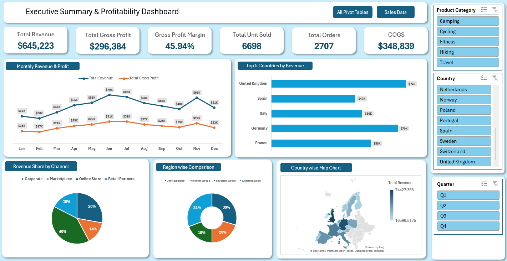

# Sales Profitability Dashboard
## Overview
An interactive Excel dashboard designed to analyze sales performance, revenue, and profitability across different countries, regions, product categories, and sales channels.
## Dashboard Preview

## Key Performance Indicators (KPIs)
- **Total Revenue:** $645,223
- **Total Gross Profit:** $296,384
- **Gross Profit Margin:** 45.94%
- **Total Units Sold:** 6,698
- **Total Orders:** 2,707
- **Cost of Goods Sold (COGS):** $348,839
## Key Features
- Monthly revenue and gross profit trends
- Top five countries by revenue
- Revenue distribution by sales channel
- Regional sales comparison
- Country-level revenue map
- Interactive filters for product category, country, and quarter
## Tools & Techniques
- Microsoft Excel
- Pivot Tables
- Interactive Slicers
- Data Visualization
- KPI Analysis
- Sales and Profitability Analysis
## Files
- `Executive_Summary_Dashboard.xlsx` — Excel workbook containing the dashboard, pivot tables, and sales data.
- `images/dashboard-preview.png` — Dashboard preview image.
## How to Use
1. Download the Excel workbook.
2. Open it in Microsoft Excel.
3. Navigate to the Dashboard sheet.
4. Use the available filters to explore sales performance.
5. Review the KPIs and charts to identify trends and compare results.
## Objective
To transform sales data into meaningful insights that support business performance monitoring and data-driven decision-making.
